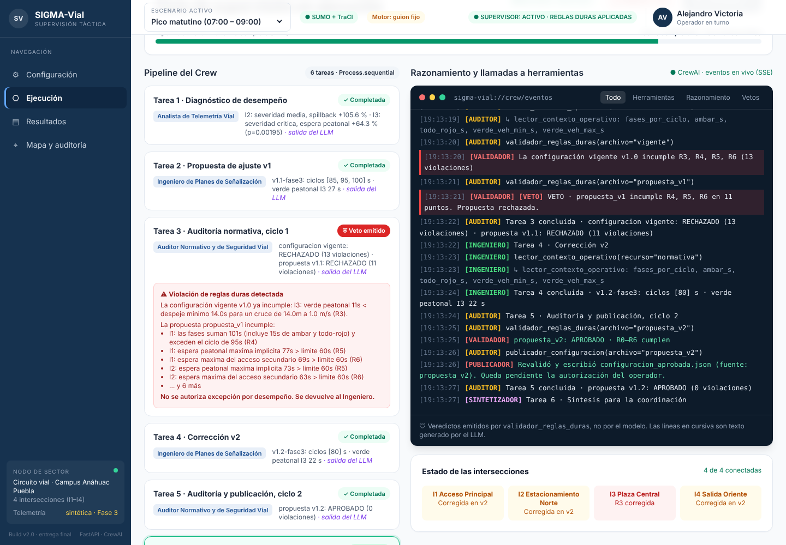
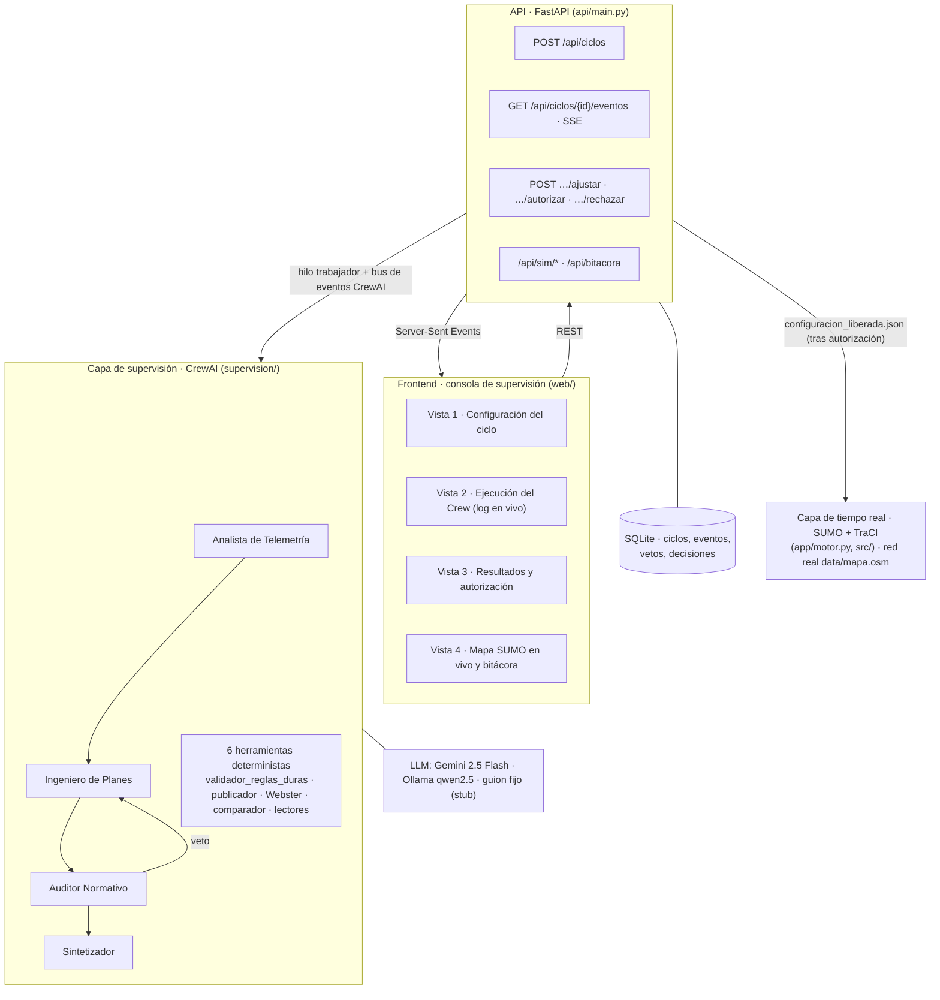
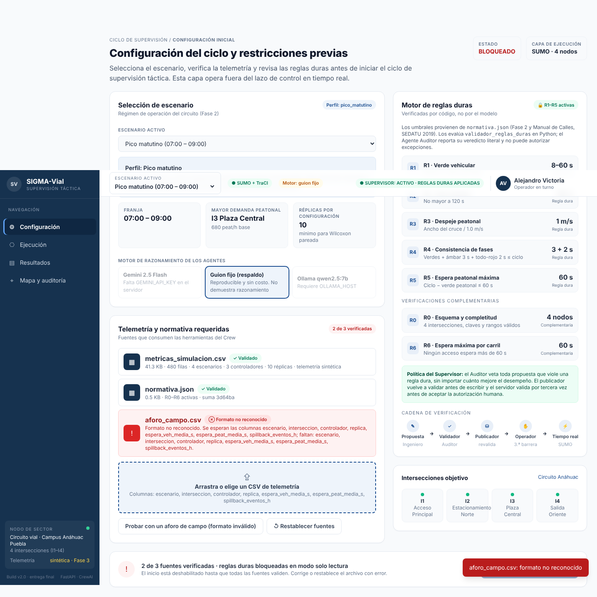
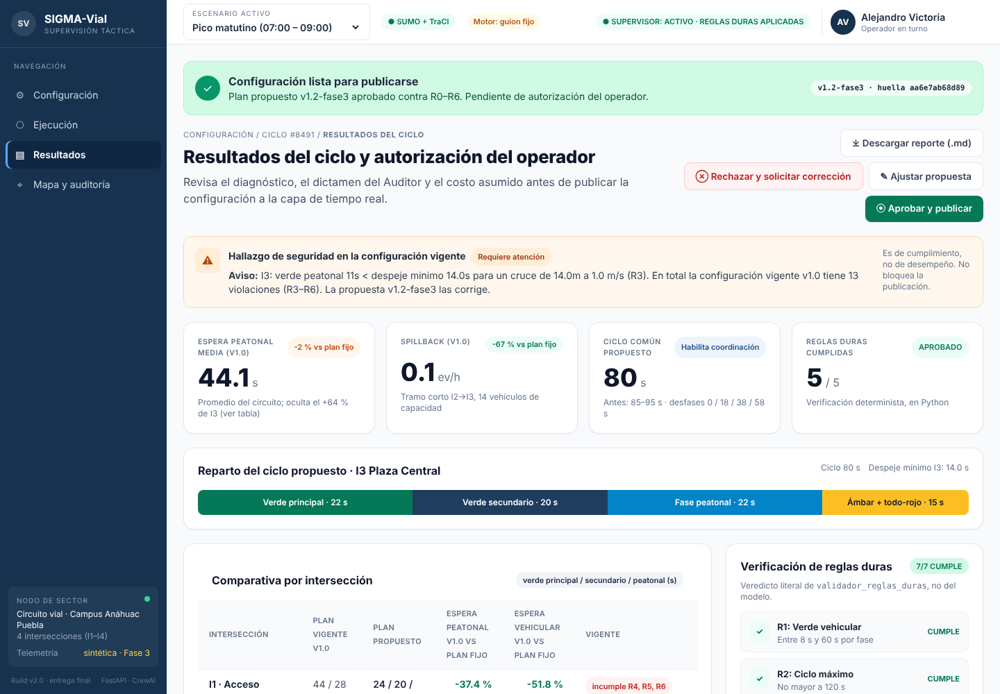
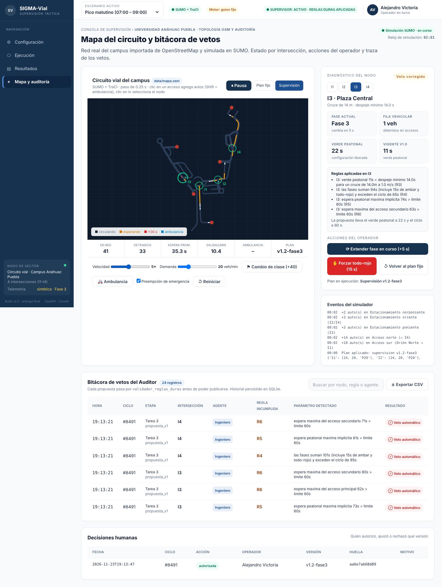

# SIGMA-Vial · Sistema multiagente para el control semafórico del campus Anáhuac Puebla

**Materia:** Inteligencia Artificial · Dr. Paulo Daniel Vázquez Mora · Universidad Anáhuac Puebla
**Equipo:** Gonzalo Novelo Suchil (00621893) · Emilio Cue Funes (00610400) · Amairany Fernández Prieto (00602972) ·
Alejandro Victoria Castelán (00614180) · Leticia Tamariz Hernández (00373898)

SIGMA-Vial controla los semáforos vehiculares y peatonales del circuito vial interno de la Universidad Anáhuac
Puebla con dos capas. Una **capa de tiempo real**, determinista y sin LLM, decide cada pocos segundos qué hace
cada semáforo. Una **capa de supervisión táctica**, construida con **CrewAI**, corre fuera del lazo de control:
diagnostica el desempeño, propone ajustes, los audita contra la normativa y deja la publicación final en manos
de una persona, desde una **consola web de supervisión con intervención humana** (Human-in-the-Loop).



---

## 1. Descripción y arquitectura

### 1.1 Resumen ejecutivo

- **Problema (Fase 1).** El circuito del campus concentra picos peatonales y vehiculares en franjas cortas
  (entrada a clases, eventos). Un plan fijo no se adapta y un controlador que solo optimiza el flujo vehicular
  sacrifica al peatón. El extracto de OpenStreetMap muestra que hoy no hay semáforos mapeados, así que el
  proyecto es una **propuesta de semaforización**.
- **Por qué multiagente.** Diagnosticar, proponer, auditar y comunicar son responsabilidades con criterios
  opuestos: el Ingeniero busca desempeño y el Auditor lo frena si viola una regla. Separarlas en agentes
  especializados con herramientas propias hace auditable cada decisión, y el lazo veto → corrección queda
  explícito en vez de ocultarse en un script monolítico.
- **Hallazgo central (Fase 3).** Bajo la configuración vigente v1.0, la espera peatonal en **I3 (Plaza Central)
  es 64.3 % peor** que con el plan fijo de Webster (Wilcoxon pareada, p = 0.00195, 10 réplicas), y además
  **incumple R3**: 11 s de verde peatonal contra un despeje mínimo de 14 s. El Crew propone v1.1, el Auditor la
  veta (R4, R5, R6), el Ingeniero corrige a v1.2 con un **ciclo común de 80 s** y verde peatonal de 22 s en I3, y
  el validador la aprueba.
- **La GUI (Fase 4)** es un dashboard B2B de supervisión: muestra qué agente produjo cada afirmación, qué
  herramienta determinista la respalda, y exige una autorización explícita antes de publicar.

### 1.2 Diagrama de componentes por capas



| Capa | Tecnología en este repo | Escalamiento a producción (Fase 4, §5.2) |
|---|---|---|
| Frontend | HTML + Tailwind compilado + JS (`web/`), sin paso de build | React 18 / Next.js con las mismas vistas |
| API | **FastAPI** + Uvicorn (`api/main.py`) | Igual |
| Transmisión en vivo | **Server-Sent Events** desde el bus de eventos de CrewAI | Igual, alimentado por Redis pub/sub |
| Ejecución del Crew | Hilo trabajador (`api/crew_runner.py`), un ciclo a la vez | Celery + Redis |
| Persistencia | **SQLite** (`data/sigma.db`) + artefactos JSON | PostgreSQL |
| Capa de tiempo real | **SUMO + TraCI** sobre la red real del campus | Controladores de campo leyendo el mismo JSON |
| LLM | Gemini 2.5 Flash · Ollama (qwen2.5:7b) · stub | Igual; el stub queda para pruebas |

### 1.3 Marco PEAS (Fase 2 · Controlador de intersección)

| | Especificación | Dónde se ve en la consola |
|---|---|---|
| **P · Desempeño** | Espera vehicular y peatonal media, eventos de spillback, rendimiento del circuito, **cero violaciones de reglas duras**; evaluado sobre 10 réplicas con Wilcoxon pareada | Vista 3: indicadores, comparativa por intersección con p-valores, dictamen R0–R6 |
| **E · Entorno** | Circuito vial del campus (4 intersecciones I1–I4, tramos compartidos), usuarios viales, demanda variable por calendario académico | Vista 4: red OSM real en SUMO. Vista 1: 4 escenarios de demanda |
| **A · Actuadores** | Extender o recortar verde, avanzar de fase, servir la fase peatonal, cambiar el plan base, todo-rojo, preempción de emergencia | Vista 4: *Extender fase*, *Forzar todo-rojo*, *Volver al plan fijo*, plan *Supervisión*, preempción de ambulancias |
| **S · Sensores** | Detectores de lazo y de área, botón y conteo peatonal, fase actual, estado de vecinos, calendario | Vista 1: telemetría validada. Vista 4: fila vehicular y fase por nodo. Vista 2: lecturas del Analista |

**Caracterización del entorno:** parcialmente observable, estocástico, dinámico, continuo y multiagente. Por eso
ningún indicador se presenta como exacto: todo es media sobre réplicas con su prueba estadística.

### 1.4 Agentes, tareas y guardrails (Fase 3)

| Agente (`role`) | `goal` (resumen) | `tools` | Delegación |
|---|---|---|---|
| Analista de Telemetría Vial | Ubicar con evidencia estadística dónde y bajo qué escenario el desempeño se aparta de las metas | `lector_telemetria_sumo`, `comparador_lineas_base`, `lector_contexto_operativo` | No |
| Ingeniero de Planes de Señalización | Convertir el diagnóstico en pesos de utilidad y planes sin inventar valores fuera de norma | `calculadora_webster`, `lector_contexto_operativo`, `lector_telemetria_sumo` | Opcional (`SIGMA_DELEGACION=1`): puede pedir al Analista más evidencia |
| Auditor Normativo y de Seguridad Vial | Impedir la publicación de cualquier configuración que viole una regla dura | `validador_reglas_duras`, `lector_contexto_operativo`, `publicador_configuracion` | No: el veto no se delega |
| Sintetizador de Movilidad | Explicar a la coordinación qué cambió, por qué y a costa de qué | ninguna | No |

`Process.sequential` con 6 tareas: `t_diagnostico` → `t_propuesta_v1` → `t_auditoria_v1` → `t_propuesta_v2` →
`t_auditoria_v2` → `t_sintesis`. El lazo de corrección es explícito y acotado (dos rondas).

**Guardrails y AI Safety**

1. Las reglas duras R0–R6 las evalúa **código Python** (`validador_reglas_duras`), nunca el LLM. El Auditor solo
   reporta el veredicto literal.
2. El validador recibe el **nombre del archivo** (`propuesta_v1`), no un JSON copiado por el LLM.
3. `guardrail` de CrewAI en las tareas de propuesta: rechaza salidas mal formadas y devuelve el error exacto.
4. **Triple barrera** antes de llegar a la capa de tiempo real: Auditor → publicador (revalida) → servidor
   (`POST /autorizar` revalida y exige la huella exacta de la versión revisada; si cambió responde **409**).
5. El operador puede ajustar la propuesta, pero el ajuste pasa otra vez por el validador; un ajuste que viole R3
   se veta igual que si lo propusiera un agente.
6. `verificacion.py` contrasta las cifras del reporte final con las salidas de las tareas previas.
7. La consola separa visualmente lo calculado por código de lo **redactado por el LLM** (texto en cursiva o con
   la etiqueta «salida del LLM»).

**Reglas duras** (`supervision/datos/normativa.json`): R1 verde vehicular 8–60 s · R2 ciclo ≤ 120 s ·
R3 despeje peatonal = ancho / 1.0 m/s · R4 verdes + ámbar 3 s + todo-rojo 2 s ≤ ciclo · R5 espera peatonal ≤ 60 s.
Verificaciones complementarias: R0 esquema y completitud · R6 espera máxima por carril ≤ 60 s.

### 1.5 Consola de supervisión (Fase 4)

| Vista | Qué hace | Estados que muestra |
|---|---|---|
| 1 · Configuración | Escenario, motor de razonamiento, validación de telemetría, reglas en solo lectura | Botón de inicio **deshabilitado** si una fuente no valida; **alerta** de formato |
| 2 · Ejecución | Pipeline de 6 tareas y log en vivo de herramientas, vetos y razonamiento (SSE) | Tarea **activa**, pendientes en gris, **veto** del Auditor con la regla incumplida |
| 3 · Resultados | Hallazgo de seguridad, indicadores, reparto del ciclo, comparativa, dictamen R0–R6, ajustar / rechazar / **aprobar y publicar** | **Confirmación** con modal y huella de versión |
| 4 · Mapa y auditoría | Simulador SUMO en vivo, diagnóstico por nodo, acciones del operador, bitácora de vetos y decisiones (exportable a CSV) | Nodos con observación, todo-rojo manual, preempción |

| Configuración | Resultados | Mapa y auditoría |
|---|---|---|
|  |  |  |

---

## 2. Prerrequisitos de software

- **Python 3.11 o 3.12** (probado con 3.12.3; otras versiones no se probaron).
- `git`.
- Dependencias fijadas en [`requirements.txt`](requirements.txt). SUMO se instala como paquete de Python
  (`eclipse-sumo`), no hace falta instalarlo aparte.
- Variables de entorno: copiar [`.env.example`](.env.example) a `.env`.
- Un motor de LLM, cualquiera de estos:
  - **Gemini** (recomendado): API key gratuita de [Google AI Studio](https://aistudio.google.com/apikey).
  - **Ollama** local con `qwen2.5:7b` (ver `supervision/Modelfile.qwen25`).
  - **Guion fijo (stub)**: no necesita nada. Las herramientas, el Crew y los vetos son reales, pero el
    razonamiento está guionado. Sirve para pruebas y como respaldo, **no** como demostración de razonamiento.

## 3. Guía de instalación y despliegue

### 3.1 Local (Windows, macOS o Linux)

```bash
git clone https://github.com/lexxvc/sigma-vial.git
cd sigma-vial
python -m venv .venv
# Windows: .venv\Scripts\activate      macOS/Linux: source .venv/bin/activate
pip install -r requirements.txt
cp .env.example .env          # Windows: copy .env.example .env
# edita .env y pega tu GEMINI_API_KEY
```

Iniciar la API y la consola (un solo proceso sirve las dos):

```bash
python -m uvicorn api.main:app --port 8000
```

Abre **http://localhost:8000**. En Windows también funciona doble clic en `iniciar.bat`.

La primera vez la vista 4 tarda unos segundos mientras `netconvert` construye la red del campus a partir de
`data/mapa.osm` (queda en `build/`).

### 3.2 Configurar el motor del LLM

| Motor | Configuración | En la consola |
|---|---|---|
| Gemini | `GEMINI_API_KEY=...` en `.env` (opcional `SIGMA_MODELO=gemini/gemini-2.5-flash`) | Tarjeta «Gemini 2.5 Flash» habilitada |
| Ollama | `ollama pull qwen2.5:7b && ollama create sigma-qwen25 -f supervision/Modelfile.qwen25`; en `.env`: `OLLAMA_HOST=http://localhost:11434` | Tarjeta «Ollama» habilitada |
| OpenAI | `OPENAI_API_KEY=...`; solo por línea de comandos (`SIGMA_LLM=openai`) | — |
| Stub | Nada | Siempre disponible |

### 3.3 Nube

- **Hugging Face Spaces (Docker).** El repositorio ya trae `Dockerfile` y el encabezado YAML de este README.
  Crea un Space tipo *Docker*, conecta este repositorio y agrega `GEMINI_API_KEY` en *Settings → Secrets*. La
  consola queda en el puerto 7860.
- **Google Colab.** [`notebooks/consola_colab.ipynb`](notebooks/consola_colab.ipynb):
  [](https://colab.research.google.com/github/lexxvc/sigma-vial/blob/main/notebooks/consola_colab.ipynb)
  → *Ejecutar todo* → abrir el link.
- **Docker local:** `docker build -t sigma-vial . && docker run -p 7860:7860 --env-file .env sigma-vial`.

### 3.4 Endpoints de la API

Documentación interactiva en **http://localhost:8000/docs** (OpenAPI generado por FastAPI).

| Método | Ruta | Uso |
|---|---|---|
| GET | `/api/sistema` | Escenarios, reglas, fuentes y motores disponibles |
| POST | `/api/fuentes` · `/api/fuentes/restablecer` | Validar o restablecer la telemetría |
| POST | `/api/ciclos` | Lanza el ciclo y devuelve `ciclo_id` de inmediato |
| GET | `/api/ciclos/{id}/eventos` | **SSE**: tareas, herramientas, vetos, razonamiento |
| GET | `/api/ciclos/{id}/resultados` | Dictamen, indicadores, comparativa y huella de versión |
| POST | `/api/ciclos/{id}/ajustar` | Ajuste humano, revalidado (422 si viola una regla) |
| POST | `/api/ciclos/{id}/autorizar` | Publica tras la tercera validación (409 si la versión cambió) |
| POST | `/api/ciclos/{id}/rechazar` | Rechazo con motivo |
| GET | `/api/ciclos/{id}/reporte` | Reporte Markdown del Sintetizador |
| GET | `/api/bitacora` · `/api/bitacora.csv` | Vetos, decisiones y ciclos (SQLite) |
| GET/POST | `/api/sim/red` · `/api/sim/estado` · `/api/sim/cmd` | Capa de tiempo real (SUMO) |

## 4. Instrucciones de reproducción

### 4.1 Datos sintéticos de prueba

Toda la telemetría es **sintética y reproducible** (semilla fija), por decisión del equipo: no se levantaron aforos
de campo.

| Archivo | Contenido |
|---|---|
| `supervision/datos/metricas_simulacion.csv` | 480 filas: 4 escenarios × 4 intersecciones × 3 controladores × 10 réplicas |
| `supervision/datos/normativa.json` | Umbrales de R0–R6 y anchos de cruce |
| `supervision/datos/configuracion_vigente.json` | Plan v1.0 (incumple R3 en I3) |
| `supervision/datos/topologia_circuito.json` · `calendario_academico.json` · `bitacora_supervisor.csv` | Contexto operativo |
| `data/mapa.osm` | Extracto real de OpenStreetMap del campus (para SUMO) |
| `web/datos_prueba/aforo_campo.csv` | Archivo con **formato inválido** para demostrar la alerta de validación |

Regenerar la telemetría: `python supervision/generar_telemetria.py`.

### 4.2 Corrida del Crew sin interfaz

```bash
cd supervision
python sigma_crew.py pico_matutino                      # stub, ~10 s, resultado idéntico siempre
SIGMA_LLM=gemini python sigma_crew.py pico_matutino     # con Gemini (Windows: set SIGMA_LLM=gemini)
```

Salidas: `supervision/salidas/` (propuestas v1 y v2, salida de cada tarea), `supervision/datos/configuracion_aprobada.json`
y `supervision/reporte_ciclo_supervision.md`.

### 4.3 Guion de la demostración en vivo (5 min)

El guion detallado, con tiempos y plan de respaldo, está en [`docs/GUION_DEMO.md`](docs/GUION_DEMO.md).

1. **Vista 1.** Escenario *Pico matutino*, motor *Gemini*. Clic en «Probar con un aforo de campo» → alerta
   y botón deshabilitado → «Restablecer fuentes» → **Iniciar ciclo**.
2. **Vista 2.** Seguir el log: lecturas del Analista, hallazgo de I3 (+64.3 %), **veto** del validador a v1.1,
   corrección a v1.2, aprobación y publicador.
3. **Vista 3.** Hallazgo R3 de la configuración vigente, comparativa, dictamen. **Ajustar** → verde peatonal
   I3 = 10 s → veto R3 → cancelar. **Aprobar y publicar** con confirmación.
4. **Vista 4.** «Aplicar en el simulador» → plan *Supervisión* en SUMO, ráfaga de cambio de clase,
   ambulancia con preempción, todo-rojo manual en I3, bitácora de vetos y decisión registrada.

### 4.4 Pruebas rápidas de la API

```bash
curl -X POST localhost:8000/api/ciclos -H "Content-Type: application/json" -d '{"escenario":"pico_matutino","motor":"stub"}'
curl -N localhost:8000/api/ciclos/<ciclo_id>/eventos          # flujo SSE
```

---

## 5. Estructura

```
sigma-vial/
├── api/                 # FastAPI: main.py (endpoints), crew_runner.py (hilo + eventos CrewAI), db.py (SQLite)
├── web/                 # consola: index.html, app.js, estilos.css, tailwind.css (compilado), datos_prueba/
├── supervision/         # Crew de la Fase 3: sigma_crew.py, herramientas.py, verificacion.py, llm_stub.py, datos/, salidas/
├── app/motor.py         # motor de tiempo real: SUMO + TraCI, preempción, acciones del operador
├── src/                 # sigma_sim.py (red, demanda, métricas) · puente.py (configuración → programas de semáforo)
├── data/mapa.osm        # red real del campus
├── notebooks/           # consola_colab.ipynb
├── docs/                # capturas y guion de la demostración
├── streamlit_app.py · vistas/   # consola alternativa en Streamlit (Fase 4, §5.4)
├── legacy/              # primer Crew en tiempo real, interfaz Flask y resultados de la versión anterior
└── requirements.txt · .env.example · Dockerfile · iniciar.bat
```

## 6. Limitaciones y trabajo futuro

- La telemetría del diagnóstico es **sintética**. El siguiente paso es generarla con SUMO: 4 escenarios ×
  3 controladores × 10 semillas.
- La red SUMO no modela peatones: la fase peatonal cuenta como rojo vehicular y la espera peatonal no se mide en
  el simulador (`netconvert --sidewalks.guess --crossings.guess`).
- La configuración de la Fase 3 supone 3 fases por intersección; en la red real I4 tiene 4 fases vehiculares.
  `src/puente.py` reparte los verdes y anota cada ajuste.
- Un ciclo a la vez por servidor (el Crew escribe a disco). Celery + Redis resuelve la concurrencia.
- Sin autenticación: el operador se identifica por nombre. Producción requiere SSO y roles.

## 7. Referencias principales

- CrewAI. (2026). *CrewAI documentation*. https://docs.crewai.com
- FastAPI. (2026). *FastAPI documentation*. https://fastapi.tiangolo.com
- Lopez, P. A., et al. (2018). Microscopic traffic simulation using SUMO. *IEEE ITSC*, 2575–2582.
- Russell, S., & Norvig, P. (2021). *Artificial intelligence: A modern approach* (4th ed.). Pearson.
- SEDATU. (2019). *Manual de calles: Diseño vial para ciudades mexicanas*. Gobierno de México.
- Webster, F. V. (1958). *Traffic signal settings* (Road Research Technical Paper No. 39). HMSO.
- Wooldridge, M. (2009). *An introduction to multiagent systems* (2nd ed.). Wiley.
