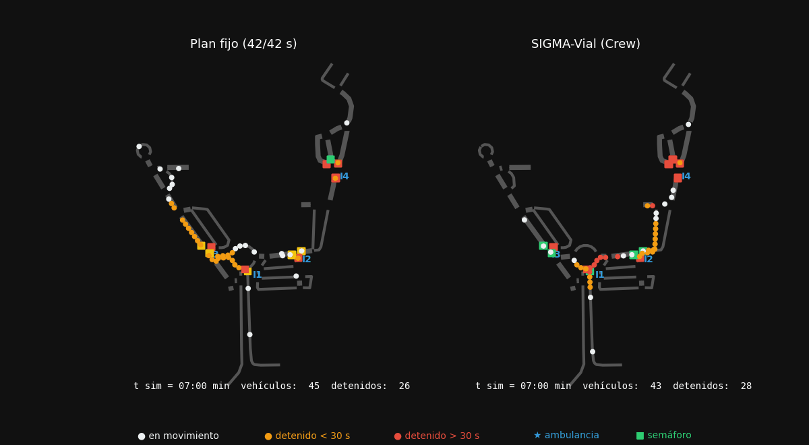
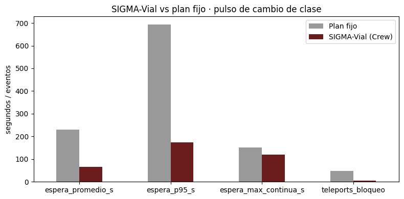
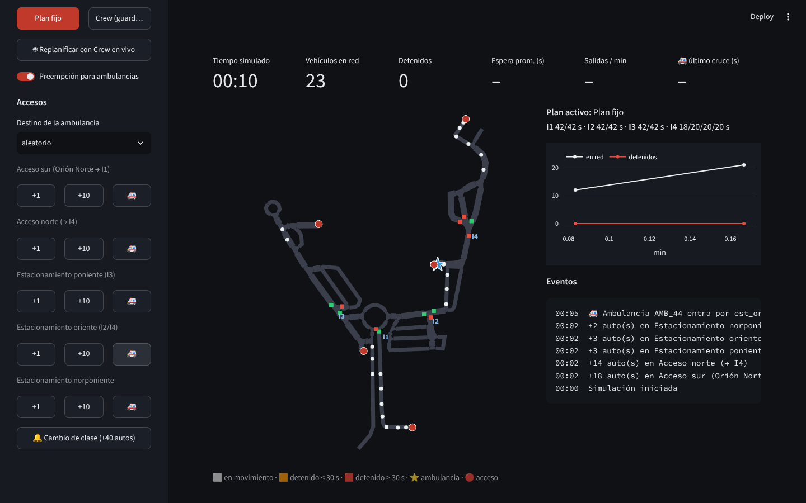
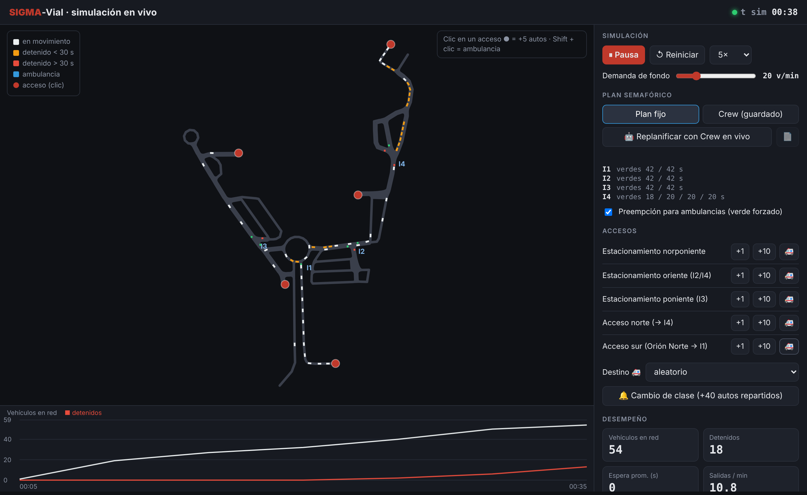

# SIGMA-Vial · Control semafórico multiagente con CrewAI + SUMO

Sistema que optimiza los tiempos de verde de 4 intersecciones del circuito interno de un campus.
Una simulación en **SUMO** entrega el estado de tráfico a un equipo de **4 agentes LLM (CrewAI)** que
deliberan un plan; un validador determinista garantiza las reglas de seguridad y el plan se re-simula
contra el plan fijo.



## Arquitectura

| Agente | Rol | Herramientas |
|---|---|---|
| Analista de Tráfico | Estima filas y demanda; detecta sensores degradados | `leer_estado_interseccion`, `estimar_fila` |
| Planificador de Fases | Maximiza la utilidad esperada U por intersección | `calcular_utilidad`, `estimar_fila` |
| Coordinador del Circuito | Evita spillback, aplica calendario, prioriza emergencias | `consultar_calendario`, `ocupacion_tramos`, `calcular_utilidad` |
| Supervisor de Seguridad | Valida reglas duras y emite el plan final | `validar_reglas` |

**Reglas duras:** verde 8–60 s · ámbar 3 s · todo-rojo 2 s · ciclo ≤ 120 s · espera peatonal ≤ 60 s.

## Resultados (misma demanda y semilla)

| Métrica | Plan fijo | SIGMA-Vial | Mejora |
|---|---:|---:|---:|
| Espera promedio (s) | 229.9 | 64.9 | 71.8 % |
| Espera p95 (s) | 694.0 | 173.0 | 75.1 % |
| Espera máx. continua (s) | 150.0 | 120.0 | 20.0 % |
| Teleports por bloqueo | 48 | 4 | 91.7 % |
| Tiempo de ambulancia (s) | 750 | 149 | 80.1 % |



Detalle: [`results/reporte_crew.md`](results/reporte_crew.md) · [`results/plan_final.json`](results/plan_final.json)

## ☁️ Correr en la nube (sin instalar nada)

La app está lista para **Streamlit Community Cloud** (gratis):

1. Entra a **https://share.streamlit.io** e inicia sesión con tu cuenta de GitHub.
2. **Create app** → *Deploy a public app from GitHub*.
3. Repository: `lexxvc/sigma-vial` · Branch: `main` · Main file path: `streamlit_app.py`.
4. En **Advanced settings** elige Python **3.12** y, si quieres usar el Crew en vivo, pega en *Secrets*:
   ```toml
   GEMINI_API_KEY = "tu_api_key"
   ```
5. **Deploy**. La primera vez tarda unos minutos en instalar; después tendrás un link `https://….streamlit.app` que abre desde cualquier navegador o celular.



Cada persona que abre el link tiene su propia simulación independiente.

## Interfaz en tiempo real (local)



App web local para ver el circuito funcionando y meter tráfico a mano:

- **Accesos:** botones `+1`, `+10` y `🚑` en los 5 accesos (sur, norte y 3 estacionamientos), o clic sobre el acceso en el mapa (Shift + clic = ambulancia).
- **Cambio de clase:** ráfaga de 40 autos repartidos entre los accesos.
- **Plan semafórico en caliente:** plan fijo ↔ plan del Crew guardado ↔ **replanificar con el Crew en vivo** (toma la foto actual de SUMO, corre los 4 agentes y aplica el plan validado).
- **Preempción de emergencia:** verde forzado (con ámbar previo) cuando una ambulancia se acerca a menos de 60 m de un semáforo.
- **Métricas en vivo:** vehículos en red, detenidos, espera promedio, salidas/min y tiempo de cruce de ambulancias.

```bash
pip install -r requirements.txt
python app/servidor.py            # abre http://localhost:5000
python app/servidor.py --sumo-gui # además abre la ventana nativa de SUMO
```

En Windows basta con doble clic en `iniciar_app.bat`. Para el Crew en vivo define antes `GEMINI_API_KEY`.

## Estructura

```
sigma-vial/
├── streamlit_app.py    # app para Streamlit Cloud
├── packages.txt        # librerías de sistema que necesita SUMO en la nube
├── .streamlit/config.toml
├── app/
│   ├── motor.py        # simulación en tiempo real (hilo dueño de TraCI)
│   ├── servidor.py     # API Flask + lanzador
│   └── static/index.html  # interfaz (mapa en canvas + panel de control)
├── notebooks/SIGMA_Vial_CrewAI.ipynb   # flujo completo con resultados
├── src/
│   ├── sigma_sim.py    # red, demanda, simulación y métricas (SUMO + TraCI)
│   ├── sigma_crew.py   # agentes, tareas y herramientas (CrewAI)
│   └── sigma_anim.py   # animación plan fijo vs Crew
├── data/               # mapa.osm del campus
├── results/            # figuras, reporte y plan final
├── iniciar_app.bat     # lanzador de la app en Windows
├── requirements.txt
└── .env.example
```

## Uso

1. Coloca el mapa en `data/mapa.osm` (ver [`data/README.md`](data/README.md)).
2. Configura `GEMINI_API_KEY` (Colab Secrets o variable de entorno; ver `.env.example`).
3. Abre `notebooks/SIGMA_Vial_CrewAI.ipynb` en Colab o local y ejecuta las celdas en orden.

```bash
pip install -r requirements.txt
```

LLM por defecto: `gemini/gemini-2.5-flash` (temperatura 0.2).

## Autor

Alejandro Victoria Castelán · Maestría en Big Data e IA — materia de Agentes Inteligentes.
